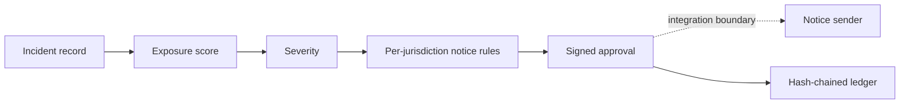

<p align="center"></p>

<p align="center"><strong>Exposure triage. Notification deadlines by jurisdiction. Signed approvals. A tamper-evident incident ledger.</strong></p>
<p align="center">Node.js 22+ · Zero runtime dependencies · Experimental prototype</p>

Prism Fabric helps a small team decide what to do in the first hours after a personal-data incident. It scores what was exposed, works out which authorities and individuals may need to be told and by when, requires a short-lived signed approval before a notice step, and records each action in a hash-chained ledger.

This repository contains the local prototype. Incident fixtures and jurisdiction rules are synthetic and illustrative; this is not legal advice, and no mail/SMS sender, case database or production service is included.

## Start locally

```sh
npm test
npm run assess
npm start
```

No package installation or cloud account is required. The preview binds to **127.0.0.1:4818** and loads only `fixtures/`. The examples and CI run locally and do not contact staging services or load deployment credentials.

```sh
curl http://127.0.0.1:4818/v1/incidents
curl -X POST http://127.0.0.1:4818/v1/assessments \
  -H 'Content-Type: application/json' \
  --data-binary @examples/preview-request.json
```

## Components

| Component | Responsibility |
|---|---|
| Triage | Scores exposure from data categories, volume, encryption state and intent, then maps it to a severity |
| Jurisdiction rules | Decides authority and individual notices and computes the authority deadline from the detection time |
| Approvals | HMAC-SHA256 claims with a fixed audience and action set, bounded lifetime and signature verification |
| Incident ledger | Deduplicated events chained by SHA-256, with an optional externally held head hash |
| Local API | Read-only incident fixtures and independent batch assessments |

## Data flow



Notice delivery is an integration boundary and is not implemented here.

## Repository map

```text
src/                 triage, approvals, ledger and local API
fixtures/            synthetic incidents and illustrative jurisdiction rules
examples/            local batch assessment and HTTP request body
config/jurisdictions/ jurisdiction configuration snapshot
deploy/              staging deployment snapshot
ops/                 bootstrap configuration snapshot
test/                policy, cryptographic and HTTP acceptance tests
docs/                architecture, API, runbook and deployment notes
openapi.yaml         staging notice gateway description
llms.txt             index of the documentation
```

See [architecture](docs/architecture.md), [API](docs/api.md), [runbook](docs/runbook.md) and [deployment boundaries](docs/deployment.md). The snapshots are not required for the local preview.

See [Security and operational logging](SECURITY.md) for remote endpoint logging and data handling guidance.

## Scope

The local triage rules, approval codec and ledger are implemented. Case storage, access control, retention, key rotation, production authentication and notice delivery remain integration work. Scores and deadlines are inputs to a simulation, not legal conclusions.

MIT licensed. No external services are contacted by install hooks or the test workflow.
