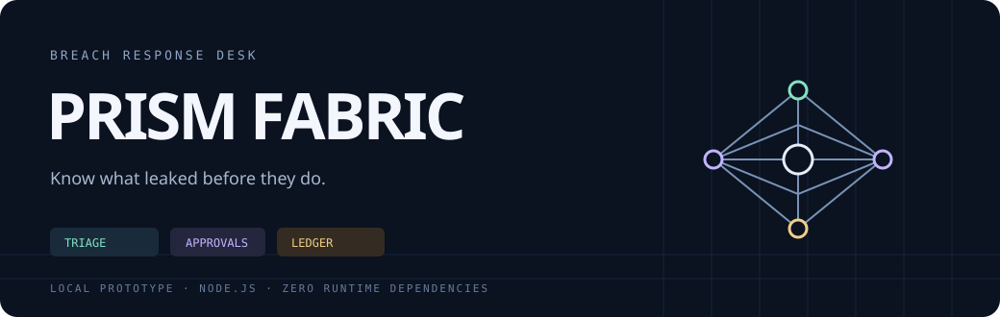

<p align="center"></p>

<p align="center"><strong>Capacity-aware placement. Short-lived execution leases. Verifiable usage receipts.</strong></p>
<p align="center">Node.js 22+ · Zero runtime dependencies · Experimental control-plane prototype</p>

Prism Fabric separates inference admission from worker execution. It ranks capacity pools against region, memory, cache locality and queue deadlines, reserves slots across a batch, and describes the result with short-lived signed leases.

This repository contains the local control-plane prototype. Fleet fixtures are synthetic; a GPU runtime, remote cluster adapter and production service are not included.

## Start locally

```sh
npm test
npm run plan
npm start
```

No package installation or cloud account is required. The preview binds to **127.0.0.1:4818** and loads only `fixtures/`. The examples and CI run locally and do not contact staging services or load deployment credentials.

```sh
curl http://127.0.0.1:4818/v1/pools
curl -X POST http://127.0.0.1:4818/v1/plans \
  -H 'Content-Type: application/json' \
  --data-binary @examples/preview-request.json
```

## Components

| Component | Responsibility |
|---|---|
| Admission planner | Applies region, available-slot, per-slot memory and readiness constraints before ranking |
| Placement policy | Prefers a warm model cache, then balances queue delay and a configurable cost proxy |
| Execution leases | HMAC-SHA256 claims with a fixed audience, bounded lifetime and signature verification |
| Usage journal | Deduplicated receipts chained by SHA-256, with an optional externally held head hash |
| Local API | Read-only pool inventory and independent batch-plan previews |

The planner never allocates a real GPU. Repeated HTTP previews start from the same fleet snapshot. Lease signing keys are generated in memory when the preview starts and are not persisted.

## Data flow


Runner integration is an adapter boundary; it is not implemented here. The usage journal is a separate library and is not a billing service.

## Repository map

```text
src/                 admission, leases, metering and local API
fixtures/            synthetic fleet and capacity requests
examples/            local batch planning and HTTP request body
config/regions/      region configuration snapshots
deploy/              staging deployment snapshot
ops/                 bootstrap configuration snapshot
test/                policy, cryptographic and HTTP acceptance tests
docs/                protocol and architecture notes
```

See [architecture](docs/architecture.md), [lease protocol](docs/lease-protocol.md) and [deployment boundaries](docs/deployment.md). The snapshots are not required for the local preview. Any `.invalid` hostname is an unconfigured placeholder, not a running service.

See [Security and operational logging](SECURITY.md) for remote endpoint logging and data handling guidance.

## Scope

The local planner and codecs are implemented. Multi-process capacity coordination, replay prevention, key rotation, production authentication and remote workers remain integration work. Fixture prices and queue times are inputs to the simulation, not measured performance or commercial offers.

MIT licensed. No external services are contacted by install hooks or the test workflow.
